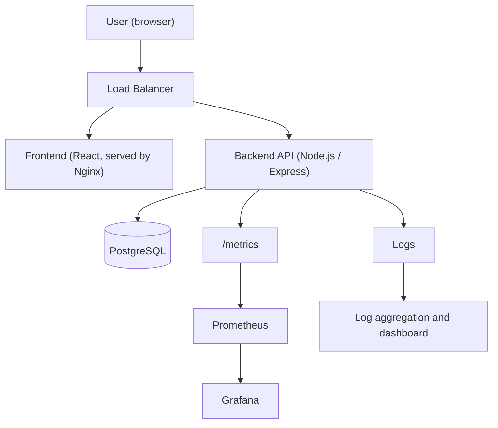
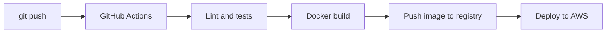

# Task Manager: a production-style Cloud & DevOps project

A small task-management web app (React + Node.js + PostgreSQL) used as the vehicle to learn and demonstrate the full DevOps chain: from a laptop to the cloud, with infrastructure as code, automated pipelines, containers orchestration and monitoring.

The application is intentionally simple. The goal of the project is **how it is built, shipped, deployed and observed**, not the features.

> **Status legend:** ✅ done · 🚧 in progress · 🔜 planned
> This README is updated at the end of every phase. Anything marked 🔜 describes the target design, not something that already exists.

---

## Table of contents

1. [Roadmap and status](#roadmap-and-status)
2. [Target architecture](#target-architecture)
3. [Tech stack](#tech-stack)
4. [Repository structure](#repository-structure)
5. [Run it locally](#run-it-locally)
6. [Configuration](#configuration)
7. [API](#api)
8. [Phase details](#phase-details)
9. [Security practices](#security-practices)
10. [Failure drills](#failure-drills)
11. [Author](#author)

---

## Roadmap and status

| # | Phase | Goal | Status |
|---|-------|------|--------|
| 1 | Application | React frontend, Node/Express REST API, PostgreSQL | 🚧 |
| 2 | Linux | Deploy manually on a Linux VM (SSH, systemd, logs) | 🔜 |
| 3 | Docker | Containerize frontend, backend and database with Docker Compose | 🔜 |
| 4 | AWS | Run on EC2, then add VPC, IAM, RDS, S3, Load Balancer, CloudWatch | 🔜 |
| 5 | Terraform | Describe all AWS infrastructure as code | 🔜 |
| 6 | CI/CD | GitHub Actions: test, build image, deploy on every push | 🔜 |
| 7 | Kubernetes | Run the stack on Kubernetes with Helm | 🔜 |
| 8 | Monitoring | Prometheus, Grafana and centralized logs | 🔜 |

**Phase 1 progress**

- ✅ Git repository on GitHub, SSH authentication
- ✅ PostgreSQL 16 installed locally, dedicated non-admin role and database
- ✅ Express server with `GET /health`, port read from the `PORT` environment variable
- 🚧 `/health` checks the database connection and reports it (the app must not crash when the database is down)
- 🔜 Configuration from `.env`, `.env.example`
- 🔜 User registration and login (JWT)
- 🔜 Tasks CRUD
- 🔜 React frontend

---

## Target architecture



**Delivery pipeline (target)**



The infrastructure behind it is created by Terraform, never by hand in the console.

---

## Tech stack

| Layer | Technology |
|-------|-----------|
| Frontend | React |
| Backend | Node.js, Express |
| Database | PostgreSQL 16 |
| Containers | Docker, Docker Compose |
| Cloud | AWS (EC2, VPC, IAM, Security Groups, RDS, S3, Load Balancer, CloudWatch) |
| Infrastructure as Code | Terraform |
| CI/CD | GitHub Actions |
| Orchestration | Kubernetes, Helm |
| Monitoring | Prometheus, Grafana, log aggregation |

---

## Repository structure

**Today**

```
task-manager/
├── backend/
│   ├── server.js
│   ├── package.json
│   ├── package-lock.json
│   └── .gitignore
└── README.md
```

**Target**

```
task-manager/
├── frontend/
│   ├── Dockerfile
│   └── ...
├── backend/
│   ├── Dockerfile
│   ├── server.js
│   └── ...
├── docker-compose.yml
├── terraform/
│   ├── main.tf
│   ├── variables.tf
│   ├── outputs.tf
│   └── terraform.tfvars        (never committed if it holds secrets)
├── k8s/                        (manifests or Helm chart)
├── .github/
│   └── workflows/
│       └── ci-cd.yml
├── monitoring/                 (Prometheus and Grafana configuration)
└── README.md
```

---

## Run it locally

### Prerequisites

- Node.js (LTS) and npm
- PostgreSQL 16
- Git

### 1. Database

Create a dedicated role and database. The application must never connect as the `postgres` admin user.

```bash
sudo -u postgres psql
```

```sql
CREATE ROLE taskmanager_user WITH LOGIN;
\password taskmanager_user
CREATE DATABASE taskmanager OWNER taskmanager_user;
```

Check the connection the way the application will use it (over TCP):

```bash
psql -h localhost -U taskmanager_user -d taskmanager
```

### 2. Backend

```bash
cd backend
npm install
npm start
```

```bash
curl -i localhost:3000/health
```

Expected response:

```json
{"status":"ok"}
```

The port comes from the environment, with `3000` as the default:

```bash
PORT=4000 npm start
```

---

## Configuration

The application is configured **only through environment variables**. Nothing sensitive is written in the code or committed to Git. This is what makes the same image run unchanged on a laptop, in Docker, on AWS and in Kubernetes.

| Variable | Purpose | Status |
|----------|---------|--------|
| `PORT` | Port the API listens on (default `3000`) | ✅ |
| `DB_HOST` | PostgreSQL host | 🔜 |
| `DB_PORT` | PostgreSQL port (default `5432`) | 🔜 |
| `DB_NAME` | Database name | 🔜 |
| `DB_USER` | Database user | 🔜 |
| `DB_PASSWORD` | Database password | 🔜 |
| `JWT_SECRET` | Secret used to sign login tokens | 🔜 |

Locally the values live in a `.env` file that is listed in `.gitignore`. A `.env.example` file (variable names only, no values) is committed so anyone can see what is required.

---

## API

| Method | Route | Description | Auth | Status |
|--------|-------|-------------|------|--------|
| GET | `/health` | Service and database health | No | 🚧 |
| POST | `/api/auth/register` | Create an account | No | 🔜 |
| POST | `/api/auth/login` | Log in, receive a token | No | 🔜 |
| GET | `/api/tasks` | List my tasks | Yes | 🔜 |
| POST | `/api/tasks` | Create a task | Yes | 🔜 |
| PUT | `/api/tasks/:id` | Update a task | Yes | 🔜 |
| DELETE | `/api/tasks/:id` | Delete a task | Yes | 🔜 |

`/health` is meant to be used by Docker healthchecks, the load balancer and Kubernetes probes. If the database is unreachable it must **report it** (not crash).

---

## Phase details

### Phase 2: Linux

Deploy the application by hand on a Linux VM, as if running it in production. Questions this phase has to answer:

- Connecting with SSH (keys, not passwords)
- Where the application lives on the filesystem
- Installing dependencies
- Providing environment variables safely
- Starting automatically at boot with a `systemd` service
- What happens when the process crashes (`Restart=on-failure`)
- Reading logs (`journalctl`)
- Troubleshooting a full disk (`df`, `du`)

### Phase 3: Docker

Fix "it works on my machine".

- `backend/Dockerfile` and `frontend/Dockerfile` (multi-stage builds, small images, non-root user)
- `docker-compose.yml` running three services: frontend, backend, PostgreSQL
- A named volume so database data survives container restarts
- Healthchecks and `depends_on` so the backend waits for the database
- The Node version in the Dockerfile matches the version used in development

### Phase 4: AWS

Start simple, then add services only when the project needs them.

```
Internet → EC2 → Docker → Application
```

Then, in this order:

1. **EC2** running the Docker Compose stack
2. **Security Groups** with minimal open ports
3. **IAM** users and roles with least privilege (no root account usage)
4. **VPC** with public and private subnets
5. **RDS** for PostgreSQL, reachable only from the backend
6. **S3** for static assets or backups
7. **Load Balancer** in front of the application
8. **CloudWatch** for logs, metrics and alarms

### Phase 5: Terraform

Goal: delete the whole AWS environment and recreate it with one command.

```
terraform/
├── main.tf
├── variables.tf
├── outputs.tf
└── terraform.tfvars
```

Workflow:

```bash
terraform init
terraform fmt
terraform validate
terraform plan
terraform apply
terraform destroy
```

Rules:

- State is stored remotely (S3), not on a laptop
- `*.tfstate`, `.terraform/` and any `*.tfvars` containing secrets are in `.gitignore`
- Every resource is defined in code; no manual changes in the AWS console
- Resources are tagged, and the environment is destroyed when not in use to control cost

### Phase 6: CI/CD

Replace the manual "SSH, pull, build, restart" routine with a pipeline.

```
git push → GitHub Actions → tests → Docker build → image → deploy to AWS
```

Planned workflow in `.github/workflows/ci-cd.yml`:

1. Trigger on push and pull request
2. Install dependencies, run lint and tests
3. Build the Docker images
4. Push the images to a registry (for example Amazon ECR)
5. Deploy to AWS on merges to `main`

Credentials are stored in GitHub Secrets, and AWS access uses short-lived credentials (OIDC) instead of long-lived access keys where possible.

### Phase 7: Kubernetes

Introduced only after Docker and the AWS deployment make sense. The question for each object is: *what problem does it solve for this application?*

| Object | Problem it solves |
|--------|-------------------|
| Pods and Deployments | Run several copies of the backend and replace failed ones |
| Services | Stable address and traffic distribution between copies |
| ConfigMaps | Non-secret configuration outside the image |
| Secrets | Database password and JWT secret outside the image |
| Ingress | One entry point routing to frontend and backend |
| Persistent Volumes | PostgreSQL data that survives pod restarts |
| Helm | Packaging and versioned releases of all of the above |

Which cluster to use (a local one such as kind or minikube first, then a managed or self-hosted one on AWS) is still to be decided.

### Phase 8: Monitoring

```
Application → /metrics → Prometheus → Grafana
Application → logs → log aggregation → dashboard
```

- The backend exposes request metrics (rate, errors, latency)
- Prometheus scrapes them, Grafana shows dashboards and alerts
- Logs are structured and collected in one place
- The tool for log aggregation is still to be decided

---

## Security practices

- No secrets in the repository, ever (`.env`, `*.tfvars` with secrets and state files are ignored)
- The application connects to the database with a dedicated, non-admin role
- SSH key authentication only
- Least-privilege IAM and minimal Security Group rules
- Database not exposed to the internet
- The repository is public, so any secret committed by mistake must be treated as leaked and rotated, since deleting the commit is not enough

---

## Failure drills

Once everything runs, the application is deliberately broken to practice investigating:

- Why is CPU high?
- Why are requests slow?
- Why did the container restart?
- Why can't the backend connect to PostgreSQL?
- The server is running out of disk space: what is using it?
- What happens to `/health` when the database is stopped?

Each drill will be documented here with symptoms, investigation steps and the fix.

---

## Author

**Yesser Boubakri**: [github.com/yesserboubakri](https://github.com/yesserboubakri)

Built as a hands-on learning project: every phase starts from a real problem, and the tool that solves it is introduced only then.